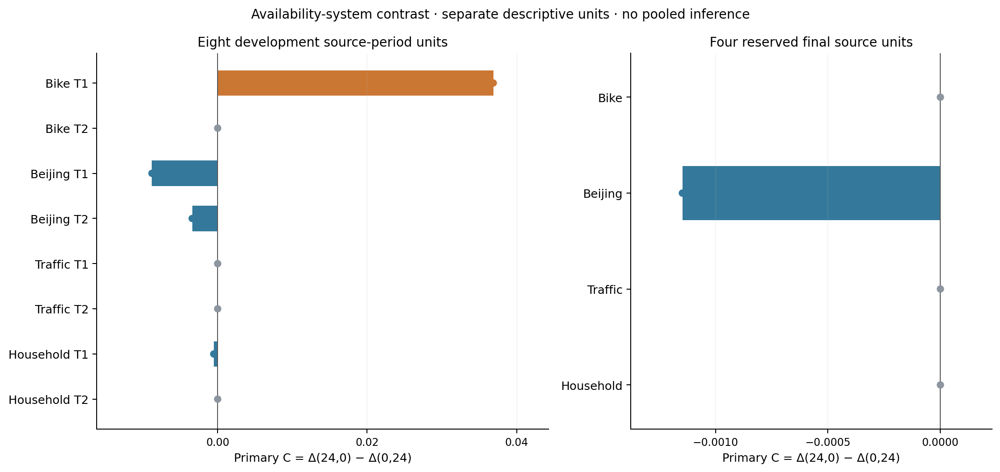

# Completed availability study: development completion and reserved final results

## Outcome in easy words

The missing baseline is finished and the reserved final evaluation ran once. This turn completed **24 baseline fits plus 48 final refits**, with no selection refresh or tuning. The expansion now has all sixteen cases and 384 evidence-backed completed fits. Across the earlier and expanded development studies, four series contribute eight related source-period units. The final evaluation adds one terminal-window unit per series. **83 final package checks passed; 0 failed.**

The final primary directions are **bike: zero; beijing: negative; traffic: zero; household: zero**. The zero sources are bike, traffic, household. In these sources the carried-forward chronological and random selectors all chose RF in both primary settings, so their equal future errors and zero contrast follow from sharing the same refit. This does not prove that validation errors, selectors or availability systems are generally equivalent.

Beijing is the final source whose carried-forward chronological and random choices differ: chronological uses HGB and random uses RF. Its native future comparison favors chronological in 4 timing settings and random in 0; any remaining settings tie. The exact scores and availability contrast are retained below. There is no basis for universal chronological superiority, statistical equivalence, a new forecasting algorithm or guaranteed publication.

## Final primary result

| Source | Primary mean | Seed minimum | Seed maximum |
| --- | --- | --- | --- |
| bike | 0.000000 | 0.000000 | 0.000000 |
| beijing | -0.001147 | -0.001147 | -0.001147 |
| traffic | 0.000000 | 0.000000 | 0.000000 |
| household | 0.000000 | 0.000000 | 0.000000 |

Let R=(selected final MAE−fixed-menu best final MAE)/historical target IQR, and Δ=R_chron−R_random. Primary C=Δ(24,0)−Δ(0,24). Positive C means the chronological-minus-random gap is larger under physical observation delay than under an equally long extra fitting-use restriction; negative C means smaller. Both primary settings have identical t+31 label maturity, legal historical training membership and final origins. Features differ. This compares whole availability systems, not an isolated causal effect of feature age.

All five split seeds are retained and summarized by mean/min/max. They share data and future candidate refits; collapsed ranges indicate identical carried-forward choices here, not independent replication. No pooled p-value or confidence interval is reported. Four heterogeneous series and related development periods provide limited coverage.

The panels preserve the eight development units and four final units separately. The different horizontal scales aid reading and do not imply comparable uncertainty or independent repeated cohorts. Full-precision results are in the CSV files.

## Final eligibility and normalization

| Source | Final eligible origins | Reserved finite hourly targets | Reserved missing hourly targets | Historical IQR |
| --- | --- | --- | --- | --- |
| bike | 3462 | 3468 | 40 | 221.000000 |
| beijing | 6899 | 6905 | 107 | 93.000000 |
| traffic | 10472 | 10478 | 32 | 3709.000000 |
| household | 6659 | 6665 | 252 | 1.277642 |

Every source-setting passed the frozen 500-history/100-final-origin and target-diversity gates. Final eligibility requires finite exact six-hour targets and finite persistence under both O values, with complete target hours ending before or at the original endpoint. The common historical IQR was computed before opening final measurements from development labels mature under the maximum t+55 restriction. Final outcomes never determine that scale.

## Every final selector and setting

Native MAE units are rental counts for Bike, µg/m³ for Beijing PM2.5, vehicles/hour for traffic, and mean kW for household power. Compare native errors within each source. A positive Δ favors random selection; a negative Δ favors chronological selection. Random means/ranges summarize five selectors sharing the same candidate refits, not five independently refitted future models.

| Source | O,L | Chron model | Random models | Earlier model | Chron MAE | Random MAE mean [min,max] | Earlier MAE | Δ mean [min,max] |
| --- | --- | --- | --- | --- | --- | --- | --- | --- |
| bike | 0,0 | RF | 42:RF; 43:RF; 44:RF; 45:RF; 46:RF | RF | 64.334552 | 64.334552 [64.334552, 64.334552] | 64.334552 | 0.000000 [0.000000, 0.000000] |
| bike | 0,24 | RF | 42:RF; 43:RF; 44:RF; 45:RF; 46:RF | RF | 64.543434 | 64.543434 [64.543434, 64.543434] | 64.543434 | 0.000000 [0.000000, 0.000000] |
| bike | 24,0 | RF | 42:RF; 43:RF; 44:RF; 45:RF; 46:RF | RF | 72.309296 | 72.309296 [72.309296, 72.309296] | 72.309296 | 0.000000 [0.000000, 0.000000] |
| bike | 24,24 | RF | 42:RF; 43:RF; 44:RF; 45:RF; 46:RF | RF | 72.330448 | 72.330448 [72.330448, 72.330448] | 72.330448 | 0.000000 [0.000000, 0.000000] |
| beijing | 0,0 | HGB | 42:RF; 43:RF; 44:RF; 45:RF; 46:RF | HGB | 32.853703 | 33.187754 [33.187754, 33.187754] | 32.853703 | -0.003592 [-0.003592, -0.003592] |
| beijing | 0,24 | HGB | 42:RF; 43:RF; 44:RF; 45:RF; 46:RF | HGB | 32.875628 | 33.272488 [33.272488, 33.272488] | 32.875628 | -0.004267 [-0.004267, -0.004267] |
| beijing | 24,0 | HGB | 42:RF; 43:RF; 44:RF; 45:RF; 46:RF | HGB | 43.098823 | 43.602395 [43.602395, 43.602395] | 43.098823 | -0.005415 [-0.005415, -0.005415] |
| beijing | 24,24 | HGB | 42:RF; 43:RF; 44:RF; 45:RF; 46:RF | HGB | 42.801847 | 43.520312 [43.520312, 43.520312] | 42.801847 | -0.007725 [-0.007725, -0.007725] |
| traffic | 0,0 | RF | 42:RF; 43:RF; 44:RF; 45:RF; 46:RF | RF | 230.920417 | 230.920417 [230.920417, 230.920417] | 230.920417 | 0.000000 [0.000000, 0.000000] |
| traffic | 0,24 | RF | 42:RF; 43:RF; 44:RF; 45:RF; 46:RF | RF | 231.029867 | 231.029867 [231.029867, 231.029867] | 231.029867 | 0.000000 [0.000000, 0.000000] |
| traffic | 24,0 | RF | 42:RF; 43:RF; 44:RF; 45:RF; 46:RF | RF | 256.637902 | 256.637902 [256.637902, 256.637902] | 256.637902 | 0.000000 [0.000000, 0.000000] |
| traffic | 24,24 | RF | 42:RF; 43:RF; 44:RF; 45:RF; 46:RF | RF | 256.695216 | 256.695216 [256.695216, 256.695216] | 256.695216 | 0.000000 [0.000000, 0.000000] |
| household | 0,0 | RF | 42:RF; 43:RF; 44:RF; 45:RF; 46:RF | RF | 0.447244 | 0.447244 [0.447244, 0.447244] | 0.447244 | 0.000000 [0.000000, 0.000000] |
| household | 0,24 | RF | 42:RF; 43:RF; 44:RF; 45:RF; 46:RF | RF | 0.447064 | 0.447064 [0.447064, 0.447064] | 0.447064 | 0.000000 [0.000000, 0.000000] |
| household | 24,0 | RF | 42:RF; 43:RF; 44:RF; 45:RF; 46:RF | HGB | 0.446653 | 0.446653 [0.446653, 0.446653] | 0.446378 | 0.000000 [0.000000, 0.000000] |
| household | 24,24 | RF | 42:RF; 43:RF; 44:RF; 45:RF; 46:RF | HGB | 0.446231 | 0.446231 [0.446231, 0.446231] | 0.450358 | 0.000000 [0.000000, 0.000000] |

## Every fixed-menu candidate

| dataset | O | L | HGB | RF | Ridge | persistence |
| --- | --- | --- | --- | --- | --- | --- |
| beijing | 0 | 0 | 32.853703 | 33.187754 | 34.752510 | 35.975939 |
| beijing | 0 | 24 | 32.875628 | 33.272488 | 34.751724 | 35.975939 |
| beijing | 24 | 0 | 43.098823 | 43.602395 | 48.403528 | 67.085665 |
| beijing | 24 | 24 | 42.801847 | 43.520312 | 48.400133 | 67.085665 |
| bike | 0 | 0 | 82.598293 | 64.334552 | 127.550278 | 273.642692 |
| bike | 0 | 24 | 82.523650 | 64.543434 | 127.707820 | 273.642692 |
| bike | 24 | 0 | 84.655629 | 72.309296 | 122.826092 | 269.756499 |
| bike | 24 | 24 | 85.079801 | 72.330448 | 122.950468 | 269.756499 |
| household | 0 | 0 | 0.451317 | 0.447244 | 0.547674 | 0.817585 |
| household | 0 | 24 | 0.448376 | 0.447064 | 0.547680 | 0.817585 |
| household | 24 | 0 | 0.446378 | 0.446653 | 0.549909 | 0.817843 |
| household | 24 | 24 | 0.450358 | 0.446231 | 0.549870 | 0.817843 |
| traffic | 0 | 0 | 274.747559 | 230.920417 | 786.891159 | 2610.381589 |
| traffic | 0 | 24 | 275.291905 | 231.029867 | 786.760747 | 2610.381589 |
| traffic | 24 | 0 | 284.041266 | 256.637902 | 800.303004 | 2624.478037 |
| traffic | 24 | 24 | 284.088318 | 256.695216 | 800.268586 | 2624.478037 |

The best final candidate is a retrospective menu oracle used only for diagnostic regret. It is not a deployable choice made with final outcomes. Every candidate prediction, including unselected candidates, is retained. Numeric/categorical preprocessing and Ridge/RF/HGB hyperparameters remain unchanged.

## Declared secondary comparisons

Entries are mean [minimum, maximum] over five seeds. Measurement=Δ(24,0)−Δ(0,0), fitting use=Δ(0,24)−Δ(0,0), factorial=[Δ(24,24)−Δ(24,0)]−[Δ(0,24)−Δ(0,0)]. These remain secondary irrespective of the primary result.

| Source | Measurement | Fitting use | Factorial |
| --- | --- | --- | --- |
| bike | 0.000000 [0.000000, 0.000000] | 0.000000 [0.000000, 0.000000] | 0.000000 [0.000000, 0.000000] |
| beijing | -0.001823 [-0.001823, -0.001823] | -0.000675 [-0.000675, -0.000675] | -0.001635 [-0.001635, -0.001635] |
| traffic | 0.000000 [0.000000, 0.000000] | 0.000000 [0.000000, 0.000000] | 0.000000 [0.000000, 0.000000] |
| household | 0.000000 [0.000000, 0.000000] | 0.000000 [0.000000, 0.000000] | 0.000000 [0.000000, 0.000000] |

Earlier-validation comparisons, also secondary:

| Source | O,L | Earlier − random | Earlier − chron |
| --- | --- | --- | --- |
| bike | 0,0 | 0.000000 | 0.000000 |
| bike | 0,24 | 0.000000 | 0.000000 |
| bike | 24,0 | 0.000000 | 0.000000 |
| bike | 24,24 | 0.000000 | 0.000000 |
| beijing | 0,0 | -0.003592 | 0.000000 |
| beijing | 0,24 | -0.004267 | 0.000000 |
| beijing | 24,0 | -0.005415 | 0.000000 |
| beijing | 24,24 | -0.007725 | 0.000000 |
| traffic | 0,0 | 0.000000 | 0.000000 |
| traffic | 0,24 | 0.000000 | 0.000000 |
| traffic | 24,0 | 0.000000 | 0.000000 |
| traffic | 24,24 | 0.000000 | 0.000000 |
| household | 0,0 | 0.000000 | 0.000000 |
| household | 0,24 | 0.000000 | 0.000000 |
| household | 24,0 | -0.000215 | -0.000215 |
| household | 24,24 | 0.003231 | 0.003231 |

## What was frozen and tested

The final plan was frozen after baseline validation and combined development interpretation, before numeric reserved measurements were inspected. All seven original T2 inner-only choices per source-setting were carried forward; FINAL_CHOICES.json retains candidate scores and original timestamps. They were re-locked before the release. No newly refreshed inner split or choice was fitted for this final test. The missing T1 baseline does not alter those T2 choices.

Deployment B is the original reserved boundary and C the original exclusive endpoint. Common candidate refits use all legal history before B, including additional development history after the earlier T2 deployment. This tests fixed selections transferring to a later deployment, not a refreshed validation-policy comparison or online adaptive learner. Fixed models predict the terminal block while legally arriving observations may update their feature vectors. Learner label arrays are NaN except at legal pre-B training rows.

Target observations for hour s arrive at s+1+O; learner fitting permission for origin-t labels is t+7+O+L. L changes label use only. Target lags and persistence stop at t−1−O; auxiliary covariates use t−1 under the inherited hypothetical completion rule. Recorded nominal time, DST ambiguity and missing actual release history remain limitations. Traffic duplicates follow exact consensus; household targets require sixty finite complete minute values and are averaged in kW. Partial endpoint hours are excluded by clock structure.

The release gate verifies protocol, code, choice, development and source hashes. An atomic once-only marker precedes the first numeric final load. The worker execution completed successfully with exactly 48 fits, 16 feasible settings and 0 infeasible settings, in 5.1 minutes. No cached or additional inner fits were used. Reserved data is now used for this final evaluation; it must not be described as still untouched or reused to select another favorable plan.

Independent checks reconstructed raw reserved targets/aggregation, as-of features, persistence sources, every physical/permission clock, all training/final memberships, historical scales, candidate scores, inner-only choices, selected metrics and declared contrast algebra. They checked exactly shared primary memberships, common final origins, lock/release/fit ordering, source integrity, and schema-union single-stream gzip integrity. The inherited checks also verify training-only preprocessing. Validation logs and hashes preserve the evidence.

## Development completion and research claim

The additional baseline passed thirteen independent completed-case checks. Its seven selectors chose RF, so the existing four expansion primary contrasts remain unchanged, while all expansion baseline-dependent secondary values are now available. The completed development interpretation is DEVELOPMENT_FINDINGS.md. Earlier source studies remain exploratory; the new preparation was frozen before inspecting its development targets. This is not formal preregistration and public held-out historical regions are not newly collected external cohorts.

The supported scope is an auditable, limited comparison of fixed-menu model selection under separately defined observation and label-use availability. The results do not establish a general advantage for chronological validation. High rates of identical candidate choice constrain the primary diagnostic's sensitivity. Any manuscript should retain those null results, source/clock limits, the carried-forward final-choice definition and the failure/completion accounting. Novelty must still be checked against the existing literature before a publication claim.

The older saved packages remain unchanged. Previous expansion execution completed 360 fits with at most twenty-one interrupted inner jobs; this authorized completion adds twenty-four, giving 384 complete expansion fits and at most 405 expansion attempts. The final evaluation adds 48 separately authorized refits. Interrupted outputs are not counted as complete evidence. The older pilot is separate from these accounting totals.

## Files and reproduction

Start with README.md for exact commands. FINAL_PROTOCOL.md, FINAL_PLAN.json, FINAL_CHOICES.json and FINAL_FREEZE.json preserve the prescoring design. FINAL_EVALUATION_STARTED.json records the single execution. final_results contains all scores, predictions, feature/maturity records, membership, scales, audit files and fit timestamps. baseline_results and development_results retain the missing-case evidence and completed merge; development_reference identifies and preserves the original score/choice inputs. Raw official source archives and their attribution are included.

The completed output checker targets the bundled directories and performs no fitting or adaptive final selection. The once-only marker blocks another final execution in this workspace. Explicit reproduction in a separate copy requires removing that copy's final_results and marker while keeping the original evidence and freeze intact, then executing the same frozen runner; this is a replay, not a new uninspected final test. Trained weights are not distributed; deterministic pipelines, source bytes, splits and predictions are retained. Redundant compressed checkpoints are omitted after combined exports validate. The package checksum list verifies every included file.
